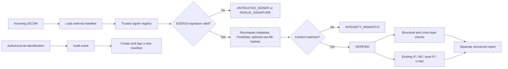

# Secure DICOM integrity verification prototype

This is an additive prototype for the existing CPAISD tamper-detection project. It does not replace the original detector baseline, retrain any model, implement the DICOM Digital Signatures Sequence, or claim clinical or production readiness.

## Integration inventory

| Capability | Existing project state | Framework behavior |
|---|---|---|
| Metadata SHA-256 | Implemented in `src/integrity.py`; current research baseline is unsigned | New versioned canonical profile is in `src/security/canonical.py`; old baseline format remains untouched |
| PixelData SHA-256 | Implemented in `src/integrity.py` and pixel experiments | New signed manifest stores raw encoded PixelData hash separately |
| Raw-file SHA-256 | Not part of existing signed workflow | Optional manifest field; changes on byte-level reserialization are expected |
| Structural / semantic checks | Existing modules in `src/validation.py` and `src/semantic_consistency.py` | Returned as independent analysis fields after verification |
| Isolation Forest / metadata AE | Inference paths exist; local bundles at `experiment_cpaisd/models/` loaded successfully during integration | Optional secondary analysis through existing loaders |
| No-reference pixel IF / U-Net | Experiment code and a local U-Net checkpoint exist | Optional outputs in `analyze`; mask is compact run-length encoded |
| HMAC / public-key signatures | Not present before this change | Added using Python `hmac` and `cryptography` Ed25519; the receiver trusts only its local registry |
| Privacy / audit | Not present as an integrated workflow | Added limited research-copy transformation, AES-GCM at-rest utility, and JSONL audit events |

Local model bundles are ignored research artifacts rather than versioned source files. The Isolation Forest and metadata autoencoder bundles loaded successfully here. The standard U-Net checkpoint was also inspected using safe weights-only loading. If artifacts are missing on another machine, inference reports them as unavailable; this framework never trains replacements.

## Architecture



## Hash and authentication scopes

- **Raw-file SHA-256** covers every serialized file byte. Rewriting or reserializing may change this digest even when parsed DICOM content is equivalent.
- **Metadata SHA-256** covers deterministic JSON serialization of dataset and file-meta elements, nested sequences, tags, VRs, and values under profile `dicom-json-v1`. PixelData and group-length elements are excluded.
- **PixelData SHA-256** covers the raw encoded value bytes of the PixelData element, not decoded pixels or a perceptual equivalence class.
- **HMAC-SHA256** authenticates a manifest with a shared secret. Both parties can create valid tags, so it does not prove which key holder produced one.
- **Ed25519** signs the exact canonical JSON bytes of the manifest. The signer ID is a key fingerprint, not identity proof by itself. The verifier must obtain the public key through a trusted channel and add it to its local registry. The envelope never supplies a trusted key.

The signature is an **external signed manifest prototype**. It is not native DICOM digital-signature conformance. Private keys, HMAC keys, and AES keys must be stored outside source control, protected by the operator, and rotated through signer registry changes. Registry and replay-cache files are security-sensitive state and require independent access controls and backups.

The privacy helper is intentionally narrower than the DICOM PS3.15 Basic Application Level Confidentiality Profile. PS3.15 covers more than PatientName/PatientID: it includes dates/times, responsible persons, organizations, private attributes, and optional clean-pixel/visual-content handling. The helper removes a selected set and flags pixel review, but it does not implement all profile tables or conformance requirements. See the [current DICOM PS3.15 confidentiality-profile section](https://dicom.nema.org/medical/dicom/current/output/chtml/part15/sect_E.2.html) and its [options](https://dicom.nema.org/medical/dicom/current/output/chtml/part15/sect_E.3.html).

## Setup and usage

Install the project dependencies, including `cryptography`:

```powershell
pip install -e ".[test]"
```

Keep secret keys in an access-controlled location outside the repository. Example sender setup:

```powershell
python -m src.security.cli keygen --private-key "$env:APPDATA\DICOMKeys\hospital-a-private.pem" --public-key "$env:APPDATA\DICOMKeys\hospital-a-public.pem"
python -m src.security.cli trust-add --registry "$env:APPDATA\DICOMKeys\trusted-senders.json" --signer-id <id-from-keygen> --public-key "$env:APPDATA\DICOMKeys\hospital-a-public.pem"
python -m src.security.cli hmac-keygen --key "$env:APPDATA\DICOMKeys\shared-hmac.secret"
python -m src.security.cli pseudonym-keygen --key "$env:APPDATA\DICOMKeys\research-pseudonym.secret"
python -m src.security.cli sign --dicom data\example.dcm --private-key "$env:APPDATA\DICOMKeys\hospital-a-private.pem" --manifest reports\example.manifest.json --hmac-key "$env:APPDATA\DICOMKeys\shared-hmac.secret"
python -m src.security.cli verify --dicom data\example.dcm --manifest reports\example.manifest.json --trust-registry "$env:APPDATA\DICOMKeys\trusted-senders.json" --expected-signer <id-from-keygen> --hmac-key "$env:APPDATA\DICOMKeys\shared-hmac.secret"
```

The public key fingerprint and public key must be exchanged and verified out of band before `trust-add`. Add a replacement signer before deactivating the prior signer with `trust-revoke`; never trust a key copied from the incoming package alone.

Analyze only after signature and content verification (supply model paths that exist locally):

```powershell
python -m src.security.cli analyze --dicom data\example.dcm --manifest reports\example.manifest.json --trust-registry "$env:APPDATA\DICOMKeys\trusted-senders.json" --if-model experiment_cpaisd\models\isolation_forest.joblib --ae-model experiment_cpaisd\models\metadata_autoencoder.joblib --pixel-model experiment_cpaisd_no_reference_v2\no_reference_pixel_model.joblib --unet-checkpoint experiment_cpaisd_supervised_localization_512_30ep_complete\unet_localizer.pt --output reports\verified_analysis.json
```

For multi-slice analysis, place each manifest sidecar under a parallel manifest directory using the DICOM relative path plus `.manifest.json` (for example `series/slice.dcm.manifest.json`). Study/series consistency checks then run only over files that first pass their individual signature and content checks:

```powershell
python -m src.security.cli analyze-directory --dicom-dir data\cpaisd\test --manifest-dir data\signed_manifests --trust-registry "$env:APPDATA\DICOMKeys\trusted-senders.json" --if-model experiment_cpaisd\models\isolation_forest.joblib --ae-model experiment_cpaisd\models\metadata_autoencoder.joblib --pixel-model experiment_cpaisd_no_reference_v2\no_reference_pixel_model.joblib --unet-checkpoint experiment_cpaisd_attention_unet_512_30ep\attention_unet_localizer.pt --output reports\verified_study_analysis.json
```

Each output file record is keyed by a hashed relative-path token. Cryptographic status, structural and semantic findings, metadata anomaly outputs, pixel anomaly masks, and segmentation masks remain separate fields.

Transform a verified source into a research copy and issue a new signature:

```powershell
python -m src.security.cli transform --dicom data\example.dcm --manifest reports\example.manifest.json --trust-registry "$env:APPDATA\DICOMKeys\trusted-senders.json" --pseudonym-key "$env:APPDATA\DICOMKeys\research-pseudonym.secret" --private-key "$env:APPDATA\DICOMKeys\hospital-a-private.pem" --output data\research\example.dcm --output-manifest reports\research\example.manifest.json
```

This transformation preserves consistent UID relationships while pseudonymizing UIDs, replaces PatientID consistently for a key, removes selected attributes and private tags, and writes a new file. It does not scrub burned-in pixels or implement the complete PS3.15 confidentiality profile. The output must be reviewed and signed as a new object; the original signature does not remain valid after transformation.

Optional authenticated encryption for at-rest storage:

```powershell
python -m src.security.cli aes-keygen --key "$env:APPDATA\DICOMKeys\storage-aes.secret"
python -m src.security.cli encrypt --input data\example.dcm --output secure\example.dsf --key "$env:APPDATA\DICOMKeys\storage-aes.secret"
python -m src.security.cli decrypt --input secure\example.dsf --output recovered\example.dcm --key "$env:APPDATA\DICOMKeys\storage-aes.secret"
```

The `.dsf` AES-GCM wrapper is an application-level at-rest container, not a DICOM transfer syntax.

## Verification outcomes and limits

`VERIFIED` means a trusted signer signed an unexpired schema-2 manifest for this receiver policy, and all manifest identifiers and required digest scopes match the file. For a directory, `overall_status` is `VERIFIED` only when every file verifies and every study matches a signed, complete instance list. It does not mean the DICOM is clinically correct or benign. `INTEGRITY_MISMATCH` means signed content or identifiers differ. `INVALID_SIGNATURE` means a trusted key did not authenticate the manifest bytes. `UNTRUSTED_SIGNER` means the key ID is not currently trusted. Missing package references and malformed input are separate outcomes. ML anomaly alerts are always kept separate from cryptographic outcomes; a low anomaly score never upgrades an unverified file to verified.

The optional replay cache stores accepted manifest IDs and the latest object version per SOP Instance UID and study. It returns `POLICY_REVIEW_REQUIRED` for a repeat or an older version. Updates are atomic across local processes through an OS file lock. It is still single-receiver state: protect it from modification, and use a durable transactional service or challenge/nonce protocol for a distributed deployment. A static signed file remains replayable until it expires if the receiver keeps no freshness state.

De-identification is a privacy risk-reduction helper only. `BurnedInAnnotation` other than `NO` triggers manual pixel-review indication; no OCR redaction is performed. Keep original and transformed files separate. Audit JSONL records contain digests and operation summaries, not patient identifiers, but should still be access-controlled and exported to an append-only protected store for stronger audit guarantees.

## Workflow hardening (manifest schema 2)

A Tamarin protocol model found workflow attacks in schema 1, and each was reproduced on the prototype. Schema 2 addresses them:

| Attack or defect | Change |
|---|---|
| Slices removed from a signed study | `sign-directory` writes a signed study manifest listing every instance; missing, added, changed or differently signed instances fail `overall_status` |
| File swapped after verification | Each file is read once, and analysis uses the dataset parsed from those verified bytes |
| Replay in analysis commands | `analyze`, `analyze-directory` and `transform` accept `--replay-cache` |
| Rollback to a superseded version | Manifests carry `object_version`; the cache rejects a version that is not newer. Use `--object-version` when reissuing |
| Replay to another receiver | Manifests can be bound with `--recipient-id` and checked with `--receiver-id` |
| Indefinite validity | Manifests carry `expires_utc`; set the lifetime with `--valid-days` (default 30) |
| Another trusted signer vouching for a study | All verification commands accept `--expected-signer`; study manifests reject instances from another signer |
| Replay-cache race | Check and commit are one locked, atomic transaction |
| Unauthenticated preamble | Verification requires the raw-file digest unless the Python API passes `allow_content_only=True` |
| Malformed sidecar stopping a run | Malformed manifests return a per-file `MISSING_REFERENCE` |
| Audit or exit status hiding a failure | Audit events record the final outcome; `verify`, `analyze` and `analyze-directory` exit 2 unless verification succeeds |

Schema 1 manifests are rejected and must be re-signed. Protections that need receiver configuration remain opt-in, and each verified result reports them under `protections`. Recommended directory exchange:

```powershell
python -m src.security.cli sign-directory --dicom-dir data\study --private-key "$env:APPDATA\DICOMKeys\hospital-a-private.pem" --manifest-dir data\signed_manifests --recipient-id hospital-b
python -m src.security.cli analyze-directory --dicom-dir data\study --manifest-dir data\signed_manifests --trust-registry "$env:APPDATA\DICOMKeys\trusted-senders.json" --expected-signer <id-from-keygen> --receiver-id hospital-b --replay-cache "$env:APPDATA\DICOMKeys\accepted-manifests.json" --output reports\verified_study_analysis.json
```

The saved results in `reports/crypto_security_full/` were produced before schema 2 and describe that earlier version.

## Reproducible checks

Run automated tests:

```powershell
pytest
```

Run the security scenario comparison against the CPAISD test fold (all files by default; `--limit 10` is useful for a smoke run):

```powershell
python scripts/run_crypto_security_experiment.py --input data\cpaisd\test --output reports\crypto_security --limit 10
```

The runner creates only temporary signing/HMAC/pseudonymization keys, edits copies in a temporary directory, and writes per-scenario outcomes, local timing estimates, and manifest sizes. The experiment does not retrain models. These local figures are not deployment benchmarks. Re-serialization is reported separately for raw-file equality and canonical metadata/PixelData equality.

The completed full-fold run is saved under `reports/crypto_security_full/` (scenario/performance CSVs, JSON summary, Markdown report, and timing chart). It processed all 809 test files across 13 scenarios (10,517 file-scenario rows). Each scenario produced the expected outcome on all 809 files: unchanged signed objects verified; metadata edits, pixel-byte flips, one-decoded-pixel edits, and preamble-only byte changes were rejected as integrity mismatches; altered/forged signatures were rejected; unknown signers, missing references, wrong HMAC keys, and cached replays produced their corresponding failure or policy statuses. A deliberately attacker-generated **unsigned** hash reference matched its edited file in all 809 cases, illustrating why an unauthenticated digest is not proof of who created the reference. An authorized research-copy de-identification followed by fresh signing verified in all 809 cases.

| Full-fold measure | Observed mean |
|---|---:|
| Manifest creation and signing | 15.44 ms/file |
| End-to-end verification | 12.82 ms/file |
| Signed envelope size | 868.4 bytes |
| Envelope / source DICOM size | 0.1647% |

For the preamble-only reserialization, the raw-file-scoped manifest rejected the byte change, while a separately signed content-only manifest (canonical metadata plus PixelData) verified it. These results demonstrate the difference between serialized-byte integrity and parsed-content integrity. Timings are local prototype measurements, not deployment benchmarks; temporary experiment keys were discarded and do not represent an institutional signer.

## Integration plan status

1. **Inventory:** complete. Existing hashes, rules, semantic checks, metadata model inference, pixel experiments, saved CPAISD metadata model bundles, and a U-Net checkpoint were located. No pre-existing authentication, signature, privacy, or integrated report framework was found.
2. **Cryptographic core:** implemented in `src/security/` with scoped hashes, HMAC, Ed25519, explicit trust registry, signed manifests, and verification outcomes.
3. **Workflow and privacy:** CLI, optional existing-model analysis, research-copy transformation with fresh signing, JSONL audit events, AES-GCM file wrapper, and local replay-cache check implemented.
4. **Verification:** 11 automated tests pass; the full 809-file CPAISD scenario runner completed all 13 scenarios with expected outcomes. No hospital deployment or DICOM-native signature conformance is claimed.

