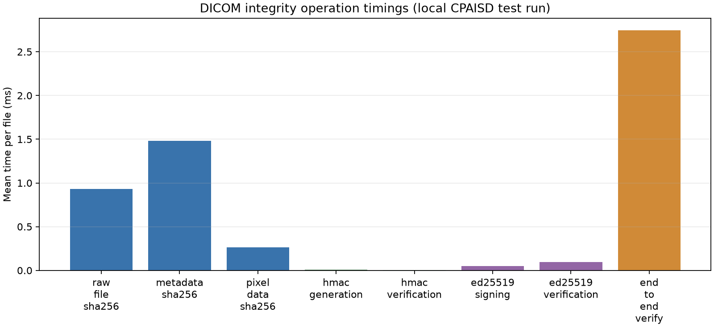

# DICOM Cryptographic Security Experiment

> Manifest schema 2, code commit `39fb4e8`. Timings come from a different machine than `reports/crypto_security_full` and are not comparable with it.

- Held-out DICOM files: 809
- Scenario rows: 10517
- Mean signed envelope: 971.4 bytes
- Mean manifest storage overhead: 0.1843% of DICOM file size
- Keys were generated temporarily for this run and deleted at exit; these results do not identify a hospital signer.

## Scenario outcomes

| Scenario | Outcome | Files |
|---|---|---:|
| altered_unsigned_digest | INVALID_SIGNATURE | 809 |
| authorized_deidentify_and_resign | VERIFIED | 809 |
| forged_signature | INVALID_SIGNATURE | 809 |
| forged_unsigned_reference | UNSIGNED_REFERENCE_ACCEPTS | 809 |
| incorrect_hmac_key | INVALID | 809 |
| metadata_change | INTEGRITY_MISMATCH | 809 |
| missing_signature | MISSING_REFERENCE | 809 |
| pixel_byte_flip | INTEGRITY_MISMATCH | 809 |
| replayed_manifest_with_local_cache | POLICY_REVIEW_REQUIRED | 809 |
| reserialization | INTEGRITY_MISMATCH | 809 |
| tiny_single_pixel_change | INTEGRITY_MISMATCH | 809 |
| unchanged_signed_file | VERIFIED | 809 |
| untrusted_signer | UNTRUSTED_SIGNER | 809 |

An unsigned forged reference matches its attacker-modified file by construction; the signed verifier returns `MISSING_REFERENCE` because no signature is present. The single-pixel scenario asserts exactly one changed decoded value for every supported test object.

## Mean operation timings

| Operation | Mean time per file (ms) |
|---|---:|
| manifest create and sign ms | 3.0785 |
| end to end verify ms | 2.7458 |
| raw file sha256 ms | 0.9289 |
| metadata sha256 ms | 1.4826 |
| pixel data sha256 ms | 0.2613 |
| hmac generation ms | 0.0111 |
| hmac verification ms | 0.0052 |
| ed25519 signing ms | 0.0474 |
| ed25519 verification ms | 0.0970 |

These values are local prototype timings, not deployment benchmarks. The replay cache is a local stateful demo and must be protected; it is not distributed replay prevention. Pixel editing was tested only for the supported uncompressed single-frame CPAISD objects.
